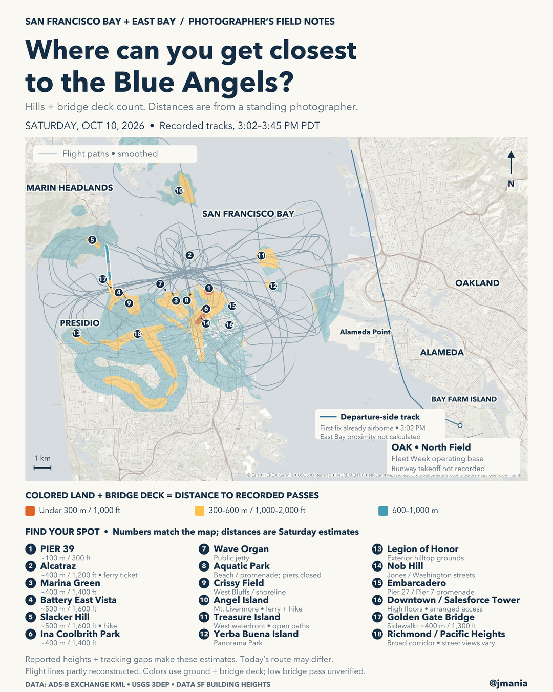

# Flightpath Photo Guide

Turn recorded flight tracks into shareable maps for photographers. Use your own
KML exports and geographic region, then optionally add terrain to estimate where
the recorded flights came closest to a standing observer.

Created by [@jmania](https://www.threads.com/@jmania) after mapping Blue Angels
passes around San Francisco Bay.



*Historical example from 10 October 2026. The screenshot shows the original
hand-tuned project, including its expanded East Bay context; it is not current
access advice or a promise about future routes. The reusable tool below has its
own configurable layout and does not reproduce every original bridge or city
annotation automatically.*

**If you want to comment, feel free to [join the discussion on Reddit](https://www.reddit.com/r/sanfrancisco/comments/1x3fn8m/if_you_want_to_get_close_to_the_blue_angels_today/).**

## What it does

- Reads timestamped KML `gx:Track` exports, including ADS-B-style files, and KML
  `LineString` geometry for path-only maps.
- Draws thin flight lines with optional display smoothing and fading ends.
- Places numbered viewpoints on the map, with names in a separate key.
- Optionally calculates three-dimensional proximity using a supplied GeoTIFF
  terrain model, explicitly aligned height references, and short flight segments.
- Exports PNG/JPEG posters, observed-path GeoJSON, an analysis report, rejected-fix
  records, and, in proximity mode, a distance GeoTIFF and viewpoint CSV.
- Uses an automatically selected local metric projection for each region.

## Quickstart

Requires Python 3.11 or newer. From a clone or downloaded copy of this repository:

```sh
python -m venv .venv
source .venv/bin/activate
python -m pip install .
python examples/make_demo.py
flightpath-photo-guide build --config examples/demo-sf-paths.yaml
```

On Windows, activate with `.venv\Scripts\Activate.ps1` in PowerShell instead.
The example is entirely synthetic: an imaginary flight over an imaginary hill.
It runs offline after dependencies are installed, without map API keys or real
aircraft data. Open `output/demo-sf-paths/map.png`.

Try terrain-aware proximity and a second region:

```sh
flightpath-photo-guide build --config examples/demo-sf-proximity.yaml
flightpath-photo-guide build --config examples/demo-london-proximity.yaml
```

The London example uses a different projection and synthetic terrain; it does
not depend on US elevation services. Example GeoTIFFs are generated locally.

## Make a map for your own region

Copy `examples/demo-sf-paths.yaml` and change:

1. `tracks.files`: paths/globs to your KML exports.
2. `region.bounds`: `[west, south, east, north]`, in longitude/latitude degrees.
3. The title, date, credit, and optional numbered viewpoints.
4. `output.directory`, `output.width`, and `output.height`.

All file paths are relative to the YAML file, not the shell's working directory.
Keep the input coordinate system in KML as longitude/latitude. Dates and titles
are explicit configuration; the tool does not assume a show date or identify
aircraft from opaque KML tracking IDs.

Start with `mode: paths`. Use `mode: proximity` only when you have a DEM and have
verified the geometric height reference of the flight export. See the full
[configuration guide](docs/configuration.md) and [methodology](docs/methodology.md).

For the historical SF case, `examples/san-francisco.yaml` provides the region,
sample viewpoints, and documented exclusions. Bring your own KML files, terrain,
and any required vertical transformation grids. Actual flight files, downloaded
map images, elevation grids, and unrelated workspace data are not bundled.

## Outputs

| File | Contents |
| --- | --- |
| `map.png`, `map.jpg` | Shareable poster; configure up to 50 million pixels |
| `tracks.geojson` | Accepted observed straight segments, not smoothed curves |
| `report.json` | Input hashes, filters, exclusions, projection, and height conversion |
| `rejected-fixes.json` | Filter/exclusion events and their reasons |
| `proximity.tif` | Proximity-mode distance raster in metres, with its metric CRS |
| `viewpoints.csv` | Geometric and terrain/building-screened estimates, when configured |

The distance raster is estimated at the configured grid and segment sampling
resolution. Increasing the poster's pixel dimensions does not improve aircraft
measurements or terrain accuracy.

## Important interpretation

The tool maps historical observations. It does not predict tomorrow's routine,
verify aircraft identity, establish public access, or guarantee visibility.
Closer is not necessarily a better photographic perspective.

Smoothed lines are illustrations. Proximity uses accepted straight segments
only, never smoothed curves or invented joins. Isolated fixes do not create
proximity hotspots. Manual exclusions are explicit and appear in the report.

KML altitude mode and filenames do **not** establish the actual altitude datum.
Unknown or barometric flight heights must not be treated as geometric sea-level
heights. If a required vertical transformation is unavailable, proximity stops
rather than using a ballpark height conversion. Optional building footprints
are obstructions, not invitations to access roofs.

## Development

```sh
python -m unittest discover -s tests -v
```

Tests cover flight discontinuities, manual exclusions, analytical distances,
height-reference validation, terrain obstruction, and offline builds in two
regions. GitHub Actions is configured for Linux, macOS, and Windows.

## License and sources

Source code and synthetic examples: [MIT](LICENSE), copyright Josh Jacobson.
The historical screenshot includes third-party map content and is not licensed
as unrestricted map data. Flight exports, terrain, building data, and basemaps
retain their respective terms and attribution requirements. See [NOTICE](NOTICE).
